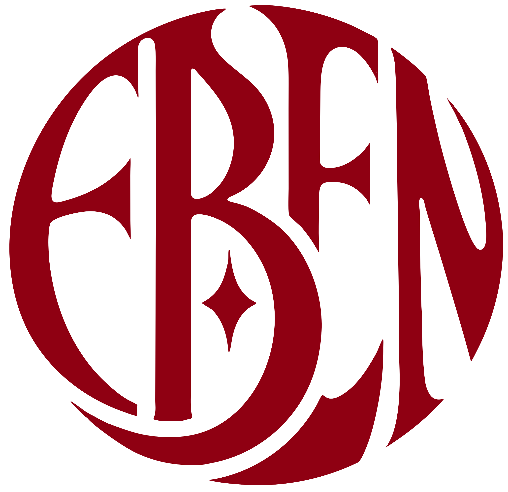

<div align="center">



# EBEN Creative Studio

**Não capturamos momentos. Eternizamos histórias.**

Landing page oficial da EBEN Creative Studio, agência de comunicação criativa e audiovisual.


</div>

---

## 📌 Sumário

1. [Sobre o projeto](#-sobre-o-projeto)
2. [Seções e funcionalidades](#-seções-e-funcionalidades)
3. [Tecnologias utilizadas](#-tecnologias-utilizadas)
4. [Instalação e execução](#-instalação-e-execução)
5. [Publicação (deploy)](#-publicação-deploy)
6. [Como atualizar o conteúdo](#-como-atualizar-o-conteúdo)
7. [Estrutura do repositório](#-estrutura-do-repositório)
8. [Documentação complementar](#-documentação-complementar)
9. [Créditos](#-créditos)

---

## 🎯 Sobre o projeto

A **EBEN Creative Studio** é uma agência de comunicação criativa e audiovisual que trabalha com três frentes: **Social Media**, **Videomaker** e **Storymaker**. O nome vem de *Ebenézer*, palavra bíblica que significa "Até aqui nos ajudou o Senhor".

Este site é uma **landing page de conversão**. Ela foi pensada primeiro para o celular, porque é por ele que chega a maior parte do público (Instagram, indicações e anúncios).

| | |
| --- | --- |
| **Objetivo principal** | Levar o visitante a **agendar uma consultoria gratuita** pelo WhatsApp |
| **Objetivo secundário** | Mostrar o portfólio e os resultados reais da agência |
| **Público** | Empresários, clínicas, marcas pessoais, empresas e quem precisa de cobertura de eventos |
| **Conversão** | Todo botão "Agendar uma consultoria" abre o WhatsApp da agência com uma mensagem pronta |
| **Princípio** | Só vai ao ar o que é real: números, cases e depoimentos apenas quando verdadeiros e autorizados |

---

## 🧩 Seções e funcionalidades

### Seções da página, na ordem em que aparecem

| # | Seção | O que entrega |
| --- | --- | --- |
| 1 | **Abertura** | Tela de entrada com o monograma da marca e uma "lente" que se abre revelando o site (uma vez por sessão do navegador) |
| 2 | **Hero (primeira tela)** | Headline "Postar todo dia não é ter presença.", fotos da Geovana em formato de Story e o botão principal |
| 3 | **Manifesto** | O conceito da marca e a proposta de valor |
| 4 | **Portfólio** | Abas por serviço (Social Media, Videomaker, Storymaker e Mobile Photo), cases com resultados e visualizador de fotos e vídeos |
| 5 | **Talvez isso soe familiar** | As dores do público, para gerar identificação |
| 6 | **O jeito EBEN** | O método (essência da marca antes do post) e os três serviços |
| 7 | **O que muda** | Os benefícios para quem contrata |
| 8 | **Como funciona** | As cinco etapas do processo, as garantias e o modelo de investimento |
| 9 | **Quem sou eu?** | A história e o propósito da Geovana Silva, fundadora da EBEN |
| 10 | **Convite da consultoria** | O que a consultoria gratuita inclui, com o botão de agendamento |
| 11 | **Objeções** | Respostas para as dúvidas mais comuns antes da contratação |
| 12 | **Perguntas frequentes** | Sanfona com as perguntas e respostas |
| 13 | **Fechamento** | Chamada final e PS |
| 14 | **Rodapé** | Slogan, WhatsApp, Instagram e crédito do desenvolvedor |

### Cases publicados

| Cliente | Atividade | Resultado |
| --- | --- | --- |
| **Sued Silva** | Cantora gospel | De 1 milhão para **1,2 milhão de seguidores** em 1 ano de gestão |
| **Juliana Arantes** | Consultora de negócios | **507 mil visualizações** e mais de 10 mil interações em 3 meses |

### Funcionalidades

- 💬 **Contato pelo WhatsApp:** todos os botões abrem uma conversa com a mensagem *"Oii, EBEN! Vim pela página e quero agendar uma consultoria."*. Esta versão **não tem formulário**: a conversão é 100% pelo WhatsApp.
- 📱 **Responsividade:** layout pensado primeiro para o celular e testado em celulares, tablets e computadores, com barra fixa do botão principal no celular.
- ✨ **Animações:**
  - Abertura com lente.
  - Um **fio dourado** que liga todas as seções e acompanha a rolagem.
  - Entradas suaves de cada bloco.
  - Retrato animado no "Quem sou eu?".
  - Brilho em movimento no convite da consultoria.

  Quem ativa "reduzir movimento" no aparelho vê a página parada.
- 🎞️ **Portfólio integrado ao Google Drive:** fotos e vídeos carregam direto do Drive e abrem num visualizador sem sair da página.
- 🔎 **SEO e dados para IA:** `robots.txt`, `sitemap.xml`, `llms.txt`, dados estruturados (JSON-LD) e página 404 própria.
- ♿ **Acessibilidade:** navegação completa pelo teclado, textos alternativos nas imagens e contraste pensado para o padrão WCAG AA.
- ⚡ **Desempenho:** site 100% estático, sem servidor, com seções carregadas sob demanda e animações feitas em CSS.

---

## 🛠 Tecnologias utilizadas

### Frontend

| Ferramenta | Uso |
| --- | --- |
| [Next.js 16](https://nextjs.org/) (App Router) | Estrutura do site, gerado como **site estático** (`output: "export"`) |
| [React 19](https://react.dev/) | Componentes da interface |
| [TypeScript](https://www.typescriptlang.org/) | Tipagem de todo o código |
| [Tailwind CSS 4](https://tailwindcss.com/) | Estilos e sistema visual (cores e fontes do brandkit) |
| [Lenis](https://github.com/darkroomengineering/lenis) | Rolagem suave |
| [Lucide](https://lucide.dev/) | Ícones |
| [Zod](https://zod.dev/) | Validação das variáveis de ambiente |
| Fraunces e Manrope | Fontes oficiais da marca (títulos e textos) |

### Backend / CMS

**Não há backend nem painel administrativo.** O site é estático: todos os textos, contatos e itens do portfólio ficam em arquivos de conteúdo dentro do código (veja [Como atualizar o conteúdo](#-como-atualizar-o-conteúdo)). As mídias do portfólio ficam no **Google Drive** da agência.

### Hospedagem

**Netlify.** A configuração está em [`netlify.toml`](netlify.toml) e o build gera a pasta `out/`, que pode ser publicada em qualquer hospedagem de arquivos estáticos.

### Qualidade

ESLint (configuração do Next.js), Prettier (com ordenação das classes do Tailwind) e checagem de tipos do TypeScript.

---

## 🚀 Instalação e execução

> **Requisito:** Node.js 20.9 ou mais recente (o Netlify usa a versão 22).

```bash
# Clonar o repositório
git clone https://github.com/Braga-ofc/EBEN-Creative-Studio.git

# Entrar na pasta do site (o projeto fica em v1/)
cd EBEN-Creative-Studio/v1

# Instalar as dependências
npm install

# Executar em modo de desenvolvimento
npm run dev
```

O site abre em **http://localhost:3000**.

### Comandos disponíveis

| Comando | O que faz |
| --- | --- |
| `npm run dev` | Roda o site em modo de desenvolvimento |
| `npm run build` | Gera a versão de produção na pasta `out/` |
| `npm run preview` | Abre a pasta `out/` como ela vai ser publicada (http://localhost:4173) |
| `npm run lint` | Verifica o código com o ESLint |
| `npm run typecheck` | Verifica os tipos do TypeScript |
| `npm run format` | Formata o código com o Prettier |
| `npm run verify:seo -- https://seudominio.com.br` | Confere o SEO no site já publicado |

### Variável de ambiente

O build de produção exige a variável `NEXT_PUBLIC_SITE_URL`, com o endereço público do site sem barra no final. Ela alimenta o canonical, o `sitemap.xml`, o `robots.txt`, o `llms.txt` e os dados estruturados. Use [`v1/.env.example`](v1/.env.example) como modelo.

```bash
NEXT_PUBLIC_SITE_URL=https://seudominio.com.br
```

---

## 🌐 Publicação (deploy)

O site é publicado no **Netlify**, com esta configuração (já definida em [`netlify.toml`](netlify.toml)):

| Configuração | Valor |
| --- | --- |
| Pasta base | `v1` |
| Comando de build | `npm ci && npm run build` |
| Pasta publicada | `out` |
| Versão do Node | `22` |
| `NEXT_PUBLIC_SITE_URL` | `https://ebencreative.netlify.app` |

Com o repositório ligado ao Netlify, cada atualização enviada para a branch principal gera uma nova publicação.

> **Domínio próprio:** quando o domínio for registrado (por exemplo, no registro.br), configure-o em *Domain management* no Netlify e troque o valor de `NEXT_PUBLIC_SITE_URL` no [`netlify.toml`](netlify.toml). Depois de publicar, rode `npm run verify:seo` com o novo endereço.

---

## ✏️ Como atualizar o conteúdo

O site não tem painel administrativo: o conteúdo é editado direto nos arquivos abaixo, todos dentro de `v1/`. Depois de editar, publique (veja [Publicação](#-publicação-deploy)).

> **Regra do projeto:** todo texto da página é aprovado primeiro em [`docs/contexto/copy.md`](docs/contexto/copy.md) e só depois copiado para o código. Nunca publique número, depoimento ou foto de cliente sem autorização.

### Mapa rápido: o que mudar e onde

| Quero mudar... | Arquivo |
| --- | --- |
| Textos de qualquer seção (títulos, parágrafos, objeções, perguntas frequentes) | [`src/content/landing.ts`](v1/src/content/landing.ts) |
| WhatsApp, mensagem do botão, horário de atendimento, perfis do Instagram, título e descrição para o Google | [`src/content/site.ts`](v1/src/content/site.ts) |
| Clientes, cases, fotos e vídeos do portfólio | [`src/content/portfolio.ts`](v1/src/content/portfolio.ts) |
| Fotos da primeira tela (Story) | `public/images/hero/` + `heroSlides` em [`site.ts`](v1/src/content/site.ts) |
| Foto do "Quem sou eu?" | `aboutPortrait` em [`site.ts`](v1/src/content/site.ts) |
| Fotos de perfil dos clientes | `public/images/portfolio/` |
| Cores, fontes e animações | [`src/app/globals.css`](v1/src/app/globals.css) e [`DESIGN.md`](v1/DESIGN.md) |

> 💡 As **perguntas frequentes** alimentam ao mesmo tempo a página, os dados estruturados do Google e o `llms.txt`. Basta mudar em um lugar.

### Como adicionar um trabalho ao portfólio

O portfólio segue a pasta **"vídeos Portfolio"** do Google Drive da EBEN: uma **aba** por serviço, um **cartão** por cliente e, dentro dele, os arquivos.

**1. Deixe o arquivo acessível no Drive.** O arquivo precisa estar compartilhado como *"Qualquer pessoa com o link"*.

**2. Copie o ID do arquivo.** É o trecho do link entre `/d/` e `/view`:

```
https://drive.google.com/file/d/1CU8wEZ1rC58_EridRW5GpMMBuPEUKnG6/view
                                └──────── ID do arquivo ────────┘
```

**3. Adicione no grupo certo** em [`src/content/portfolio.ts`](v1/src/content/portfolio.ts). Para um **cliente novo**, crie um grupo dentro da aba do serviço:

```ts
{
  id: "nome-do-cliente",            // identificador único, sem espaços nem acentos
  name: "Nome do Cliente",          // nome que aparece no cartão
  media: [
    { driveId: "ID_DO_VIDEO", kind: "video" },
    { driveId: "ID_DA_FOTO", kind: "photo", alt: "Descrição do que aparece na foto" },
  ],
},
```

Os tipos de mídia são:

| `kind` | Quando usar |
| --- | --- |
| `"video"` | Vídeos (o Drive converte .mov e .mp4 para tocar em qualquer navegador) |
| `"photo"` | Fotos, com o campo `alt` descrevendo a imagem |
| `"screen"` | Prints de tela do celular, também com `alt` |

A **primeira mídia** do grupo vira a capa do cartão.

**4. (Opcional) Transforme em case de Social Media.** Os cases com resultado, como os da Sued Silva e da Juliana Arantes, aceitam campos extras:

```ts
{
  id: "nome-do-cliente",
  name: "Nome do Cliente",
  avatar: "/images/portfolio/nome-do-cliente-perfil.webp", // foto de perfil ao lado do nome
  role: "Profissão ou área de atuação",                     // aparece abaixo do nome
  result: {
    value: "507 mil",                                       // número em destaque
    label: "visualizações",
    text: "Frase curta explicando o resultado e o período.",
  },
  media: [/* ... */],
},
```

**Foto de perfil:** quadrada, em WebP, com 320 × 320 px, salva em `public/images/portfolio/`.

**Vídeo principal do case:** pode ficar no próprio site, em vez do Drive. Use `src` e `poster` no lugar de `driveId`, com o vídeo em MP4 (H.264) dentro de `public/videos/`.

### Como trocar as fotos da primeira tela

1. Exporte a foto em **WebP, na vertical (9:16)**, com 900 × 1600 px, deixando a pessoa perto do centro.
2. Salve em `v1/public/images/hero/`.
3. Atualize `src` e `alt` do item correspondente em `heroSlides`, no arquivo [`site.ts`](v1/src/content/site.ts). A legenda de cada foto fica em `hero.storyBeats`, no arquivo [`landing.ts`](v1/src/content/landing.ts), na mesma ordem.

---

## 📁 Estrutura do repositório

```
EBEN-Creative-Studio/
├── netlify.toml              configuração de publicação no Netlify
├── docs/
│   ├── contexto/             PRD, copy aprovada, design, regras, tarefas e histórico de decisões
│   └── marca/                monograma e estrela da marca (SVG)
└── v1/                       o site
    ├── DESIGN.md             sistema visual (cores, fontes, componentes e animações)
    ├── PRODUCT.md            contexto de produto e público
    ├── public/
    │   ├── brand/            logo e símbolos da marca
    │   ├── images/           fotos da primeira tela, do manifesto e do portfólio
    │   └── videos/           vídeo principal do case da Sued Silva
    ├── scripts/              preview local e verificação de SEO
    └── src/
        ├── app/              página, layout, estilos, 404, robots, sitemap e llms.txt
        ├── components/       marca, layout, seções da página e botões
        ├── content/          ✏️ textos, contatos e portfólio (onde o conteúdo é editado)
        └── lib/              WhatsApp, variáveis de ambiente, dados estruturados e llms.txt
```

---

## 📚 Documentação complementar

| Documento | Conteúdo |
| --- | --- |
| [`v1/README.md`](v1/README.md) | Guia técnico detalhado: build, SEO, decisões e pendências |
| [`v1/DESIGN.md`](v1/DESIGN.md) | Sistema visual completo e regras de design |
| [`v1/PRODUCT.md`](v1/PRODUCT.md) | Propósito, público e princípios do produto |
| [`docs/contexto/prd.md`](docs/contexto/prd.md) | Requisitos do produto |
| [`docs/contexto/copy.md`](docs/contexto/copy.md) | Texto aprovado de cada seção |
| [`docs/contexto/rules.md`](docs/contexto/rules.md) | Regras de código do projeto |
| [`docs/contexto/memory.md`](docs/contexto/memory.md) | Histórico das decisões, em ordem cronológica |

---

## 🤝 Créditos

| | |
| --- | --- |
| **Cliente** | EBEN Creative Studio, por Geovana Silva |
| **Instagram** | [@eben.creative_](https://www.instagram.com/eben.creative_/) e [@geoo.silvaz](https://www.instagram.com/geoo.silvaz/) |
| **WhatsApp da agência** | [+55 61 99454-1957](https://wa.me/5561994541957) |
| **Desenvolvimento** | **BRAGA SYSTEMS** · [61 99422-7093](https://wa.me/5561994227093) |

<div align="center">

<sub>EBEN, de <i>Ebenézer</i>: "Até aqui nos ajudou o Senhor".</sub>

</div>
